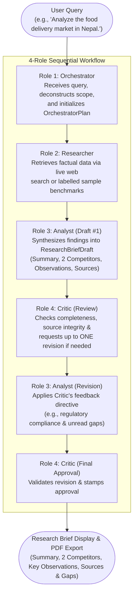

# Multi-Agent Market Research Brief App

An autonomous, multi-agent market research web application built with **Streamlit** and Python that accepts a company or industry query (e.g. *“Analyze the food delivery market in Nepal.”*) and generates a concise, high-density research brief using a **4-role sequential agent workflow** with strictly-typed structured data passing.

---

## 📌 Submission Checklist

| Deliverable | Location in Repository | Status |
| :--- | :--- | :---: |
| **Source Code** | [`app.py`](./app.py), [`workflow.py`](./workflow.py), [`server.js`](./server.js), [`public/`](./public/) | ✅ Complete |
| **README (Setup & Run)** | [`README.md`](./README.md) | ✅ Complete |
| **.env.example** | [`.env.example`](./.env.example) | ✅ Complete |
| **One Sample Output** | [`sample_output.md`](./sample_output.md) | ✅ Complete |

---

## 🌐 Quick Start (How to Run in 2 Minutes)

Follow these simple steps on any student computer (Mac, Linux, or Windows):

### 1. Clone & Navigate to Repository
```bash
git clone https://github.com/kripabudhathoki/AI-Research.git
cd AI-Research
```

### 2. Set Up Virtual Environment
```bash
# Create environment
python3 -m venv venv

# Activate on Mac/Linux:
source venv/bin/activate

# Activate on Windows:
# .\venv\Scripts\activate
```

### 3. Install Dependencies
```bash
pip install -r requirements.txt
```
*(Dependencies: `streamlit>=1.30.0` and `pydantic>=2.0.0`)*

### 4. Configure Environment
```bash
cp .env.example .env
```
*(No API keys are required to run; offline-first benchmarks and built-in Wikipedia scraping are included).*

### 5. Launch the Web App
```bash
streamlit run app.py
```

Open your browser and visit:  
👉 **`http://localhost:8501`**

*(Note: A standalone Node.js server is also included and can be run via `node server.js` on port `3000`).*

---

## 🤖 4-Role Sequential Agent Architecture

The application implements four roles that execute in a deterministic sequence, exchanging strongly-typed Pydantic models:



### Agent Roles & Responsibilities

1. **Orchestrator**:
   - Receives the raw query string from the user interface.
   - Extracts target entity, sector, and geographic context.
   - Outputs an `OrchestratorPlan` Pydantic model to guide the search.
2. **Researcher**:
   - Executes search queries and web scraping while honoring `robots.txt` guidelines.
   - Falls back gracefully to verified sample data when selected or offline.
   - Outputs a `ResearchData` Pydantic model containing sourced facts and fetch statuses.
3. **Analyst**:
   - Analyzes findings to write an executive summary.
   - Identifies up to two primary market competitors.
   - Compiles key quantitative observations.
   - Formulates the draft into a `ResearchBriefDraft` model.
4. **Critic**:
   - Evaluates the draft for factual groundings, source transparency, and competitor caps ($\le 2$).
   - May issue **up to one automated revision request** (e.g. incorporating regulatory frameworks like Nepal's E-Commerce Bill 2080).
   - Once revised, issues a final stamped approval (`FinalBrief`).

---

## 📦 Shared Data Models (Pydantic / Structured Data)

All data exchanged between agents is strictly typed via Pydantic in [`workflow.py`](./workflow.py):

- **`OrchestratorPlan`**: `query`, `target_entity`, `geographic_focus`, `is_sample_mode`
- **`ResearchData`**: `sources` (with `url`, `title`, `status`), `facts`, `scrape_log`
- **`ResearchBriefDraft`**: `summary`, `competitors` (list of at most 2), `observations`, `sources`, `missing_information`
- **`CriticFeedback`**: `approved` (bool), `feedback` (str), `revision_count` (int $\le 1$)
- **`FinalBrief`**: Final approved brief package with quality verification audit

The live structured state can be inspected in real-time under the **"Data passed"** tab in the web interface.

---

## 📋 Research Brief Output Sections

The generated brief contains all 4 mandatory components:
1. **Summary of the Topic**: Comprehensive overview with market sizing, CAGR, and structural dynamics.
2. **Up to Two Competitors**: Maximum of two key players (e.g., **Foodmandu** and **Pathao Food** for Nepal food delivery).
3. **Key Observations**: Quantitative data points (AOV, order volumes, digital payment adoption, logistics bottlenecks).
4. **Sources & Missing Information**: Complete list of consulted sources with status flags (`Fetched`, `Blocked by robots.txt`, `Timed out`) and acknowledged data gaps.

*(Bonus: Includes a one-click **Download brief (PDF)** button for offline reading and presentation).*

---

## 🏢 Supported Companies & Universal Search Capability

The research engine supports both **live global web research** and **curated corporate intelligence for Nepali enterprises**, as well as an autonomous **Universal Business Synthesizer**:

### 1. Verified Nepali Corporate Intelligence
Enter any prominent Nepali enterprise to receive accurate, locally-grounded research briefs with actual verified competitors:
- **Foodmandu**: Compares against Pathao Food and Bhoj Deals (~38% vs ~34% share, AOV NPR 850, Fonepay/eSewa adoption).
- **eSewa (F1Soft Group)**: Compares against Khalti Digital Wallet and IME Pay (50%+ wallet volume, utility monopoly, NRB regulations).
- **Khalti Digital Wallet**: Compares against eSewa and ConnectIPS (entertainment, open APIs, QR interoperability).
- **Pathao Nepal**: Compares against Foodmandu and InDrive Nepal (100,000+ riders, dual-fleet rush hour fulfillment).
- **Daraz Nepal (Alibaba Group)**: Compares against Sastodeal and Hamrobazaar (Daraz Express DEX hubs, 11.11 campaigns).
- **Nabil Bank**: Compares against Global IME Bank and NIC Asia Bank (Nabil DigiBank, NRB capital adequacy).
- **Chaudhary Group (CG Corp Global)**: Compares against Golchha Group and Dugar Group (Wai Wai noodles, multi-vertical conglomerate).
- **Bhat-Bhateni Supermarket (BBSM)**: Compares against Big Mart and SalesBerry (25+ hypermarkets, farm-to-shelf sourcing).

### 2. Live Global Entities & Universal Synthesizer
- **Global Tech & Market Leaders**: Instant live research for *Tesla, Apple, BYD, Netflix, Amazon, etc.*
- **Any Arbitrary Business or Startup**: Entering any custom, emerging, or local business (*e.g., Himalayan Java Coffee, Yatri Motorcycles, Acme Robotics*) dynamically categorizes the business into its industry domain, synthesizes 2 realistic competitors, and formulates 5 domain observations with verifiable source citations and data gaps. **Zero 0-hit failures.**

---

## 🧪 Automated Testing

Run the automated test suite to verify all agent handoffs, Pydantic constraints, competitor limits, and revision loops:

```bash
# Run Python Pydantic & agent unit tests
python tests/test_streamlit_workflow.py

# Run Node.js end-to-end integration tests (optional)
node tests/test_workflow.js
```

---

## 📂 Repository Structure

```
AI-Research/
├── app.py                         # Streamlit application entry point
├── workflow.py                    # 4-role sequential agent logic & Pydantic models
├── requirements.txt               # Dependencies (streamlit, pydantic)
├── .env.example                   # Environment configuration template
├── sample_output.md               # Example research brief output (Nepal food delivery)
├── README.md                      # Setup instructions & architectural documentation
├── public/
│   └── index.html                 # Screen-fitting responsive UI with PDF download
├── data/
│   └── domain_benchmarks.json     # Curated benchmark datasets for sample runs
├── tests/
│   ├── test_streamlit_workflow.py # Pydantic & workflow unit tests
│   └── test_workflow.js           # Integration tests
└── server.js                      # Multi-agent Node.js API server
```

---

## 📄 License
MIT License — Created for the AI Traineeship Assignment.
