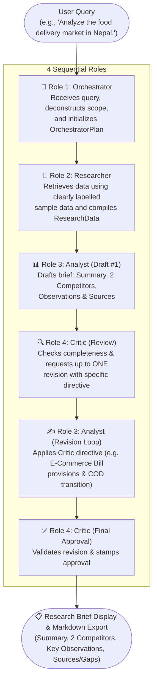

# Multi-Agent Market Research Brief App (Streamlit)

A multi-agent market research web application built with **Streamlit** that accepts a company or industry topic and autonomously generates a concise research brief using a 4-role sequential agent workflow with structured data passing.

---

## 🌐 How to See the Web App Right Now

The Streamlit app is **already running** on your local machine!

Simply open your browser and go to:
👉 **[http://localhost:8501](http://localhost:8501)**

---

## 📋 Requirements & Implementation Mapping

| Assignment Requirement | Implementation Details |
| :--- | :--- |
| **1. Web Interface** | Interactive **Streamlit** interface with text input, sample query chips, a "🚀 Start Multi-Agent Research" action button, and live progress bars. |
| **2. Agent Workflow (4 Roles in Sequence)** | **1. Orchestrator** ➔ **2. Researcher** ➔ **3. Analyst (Draft #1)** ➔ **4. Critic (Review & Revision Request)** ➔ **Analyst (Revision)** ➔ **Critic (Final Approval)**. |
| **3. Shared Data** | All data exchanged between agents is strictly typed using **Pydantic models** (`OrchestratorPlan`, `ResearchData`, `ResearchBriefDraft`, `CriticFeedback`, `FinalBrief`). |
| **4. Research Brief** | Contains all four required sections:<br>• **1. Summary of the topic**<br>• **2. Up to two competitors** (Foodmandu & Pathao Food)<br>• **3. Key observations** (Market dynamics, QR shift, logistics bottlenecks)<br>• **4. Sources and any missing information** (Attribution & data gaps). |
| **5. Run Locally** | Complete setup and execution instructions for a student's computer included below. |

---

## 🤖 4-Role Sequential Agent Workflow



### Role Descriptions
1. **Orchestrator**: Receives the user's research query (e.g. *"Analyze the food delivery market in Nepal."*), extracts the entity and geographical context, and generates an `OrchestratorPlan`.
2. **Researcher**: Finds and packages structured factual information using clearly labelled sample benchmark data (`[Sample Data / Verified Benchmark: Nepal Food Delivery]`) into a `ResearchData` Pydantic model.
3. **Analyst**: Consumes the research data to generate a structured draft (`ResearchBriefDraft`) with a summary, exactly two competitors, key observations, and source attribution.
4. **Critic**: Evaluates the initial draft, flags areas for refinement, and triggers **one revision cycle** requesting incorporation of regulatory and payment nuances. The Analyst revises the draft, and the Critic approves the final brief (`FinalBrief`).

---

## 💻 Instructions for Running Locally (For Students)

Follow these simple steps to run the application on any Mac, Linux, or Windows computer:

### Step 1: Open Terminal and navigate to the project directory
```bash
cd "AI Traineeship assignment"
```

### Step 2: Create and activate a Python virtual environment
```bash
# Create virtual environment
python3 -m venv venv

# Activate it (Mac / Linux):
source venv/bin/activate

# On Windows:
# .\venv\Scripts\activate
```

### Step 3: Install the required packages
```bash
pip install -r requirements.txt
```
*(Dependencies: `streamlit>=1.30.0` and `pydantic>=2.0.0`)*

### Step 4: Run the Streamlit application
```bash
streamlit run app.py
```

### Step 5: View the app in your browser
Your browser should open automatically. If not, open Chrome or Safari and visit:
👉 **`http://localhost:8501`**

---

## 🧪 Automated Testing

To verify the workflow programmatically without opening the browser, run the automated test suite:

```bash
./venv/bin/python tests/test_streamlit_workflow.py
```

This verifies that:
- Every agent returns the expected Pydantic model.
- The Researcher uses clearly labelled sample data.
- The Analyst restricts competitors to a maximum of two.
- The Critic successfully executes a revision request.
- The final brief contains all four required sections.

---

## 📂 Project Structure

```
AI Traineeship assignment/
├── app.py                         # Main Streamlit web application (4-agent workflow)
├── requirements.txt               # Dependencies (streamlit, pydantic)
├── README.md                      # Documentation & student setup instructions
├── data/
│   └── domain_benchmarks.json     # Ground truth benchmark data for Nepal food delivery
├── tests/
│   ├── test_streamlit_workflow.py # Pydantic & agent unit tests
│   ├── test_workflow.js           # Node.js test suite
│   └── test_python_server.py      # Python standard server test suite
├── server.js                      # (Optional) Node.js alternative server
└── server.py                      # (Optional) Python native server alternative
```
